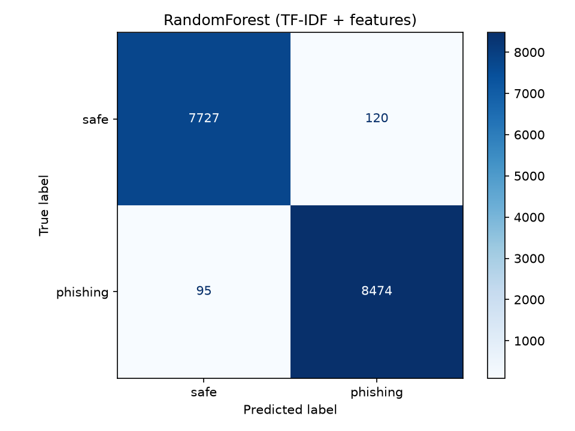
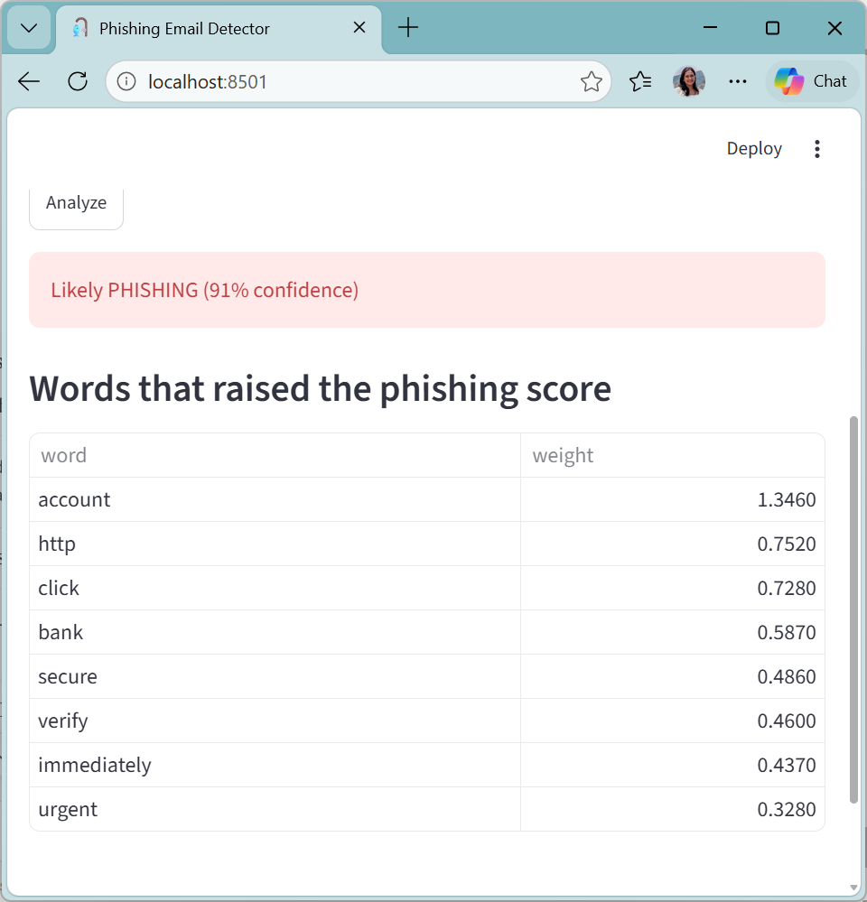
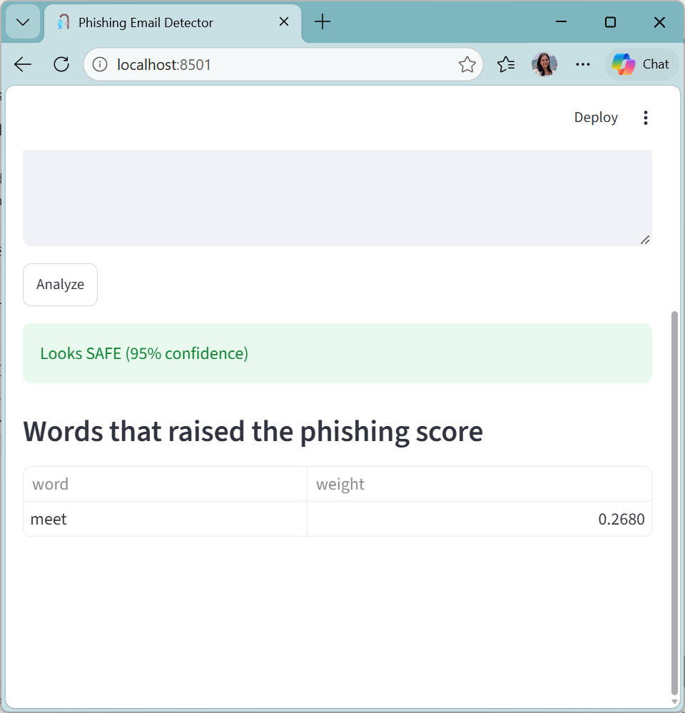

# Phishing Email Detector

Classifies emails as phishing or safe using NLP and Scikit-learn. A Streamlit demo shows the verdict, the confidence, and the words that drove the prediction.

## What changed from version 1
- **v1:** 10 hand-written emails, CountVectorizer + Naive Bayes. The test set had only 2 emails, so the accuracy was not meaningful.
- **v2:** about 82,000 real emails, duplicates removed, stratified train/test split, TF-IDF with word pairs, hand-crafted features (URL count, IP-based links, urgency words, capital-letter ratio), three models compared, and a web demo.

## Results (16,416 test emails)

| Model | Accuracy | Phishing precision | Phishing recall | Phishing F1 |
|---|---|---|---|---|
| Random Forest (TF-IDF + features) | 98.69% | 98.60% | 98.89% | 98.75% |
| Logistic Regression (TF-IDF + features) | 98.56% | 98.36% | 98.88% | 98.62% |
| Naive Bayes (TF-IDF) | 96.67% | 98.95% | 94.62% | 96.74% |

Phishing **recall** is the metric I focused on, because a missed phishing email costs more than a false alarm. The original Naive Bayes model missed about 5% of phishing emails; the two upgraded models miss about 1%.



## Demo



## Run it
1. Download the Kaggle "Phishing Email Dataset" and place `phishing_email.csv` in this folder.
2. Install and train:
```
pip install -r requirements.txt
python train.py --data phishing_email.csv --text-col text_combined --label-col label
```
3. Start the demo:
```
streamlit run app.py
```

## Limitations
- The dataset combines several sources (Enron, SpamAssassin and others), so scores near 99% may partly reflect source-specific writing styles. Testing on a separate dataset is the next step.
- Text only: no header, sender-domain or attachment analysis.
- Very short messages differ from the long emails the model was trained on.

## Next steps
- Fine-tune DistilBERT and add it to the comparison.
- Add email-header features.
- Evaluate on an independent dataset.

Educational / cybersecurity learning project.